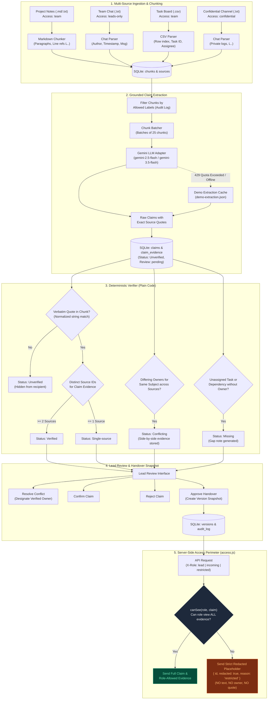
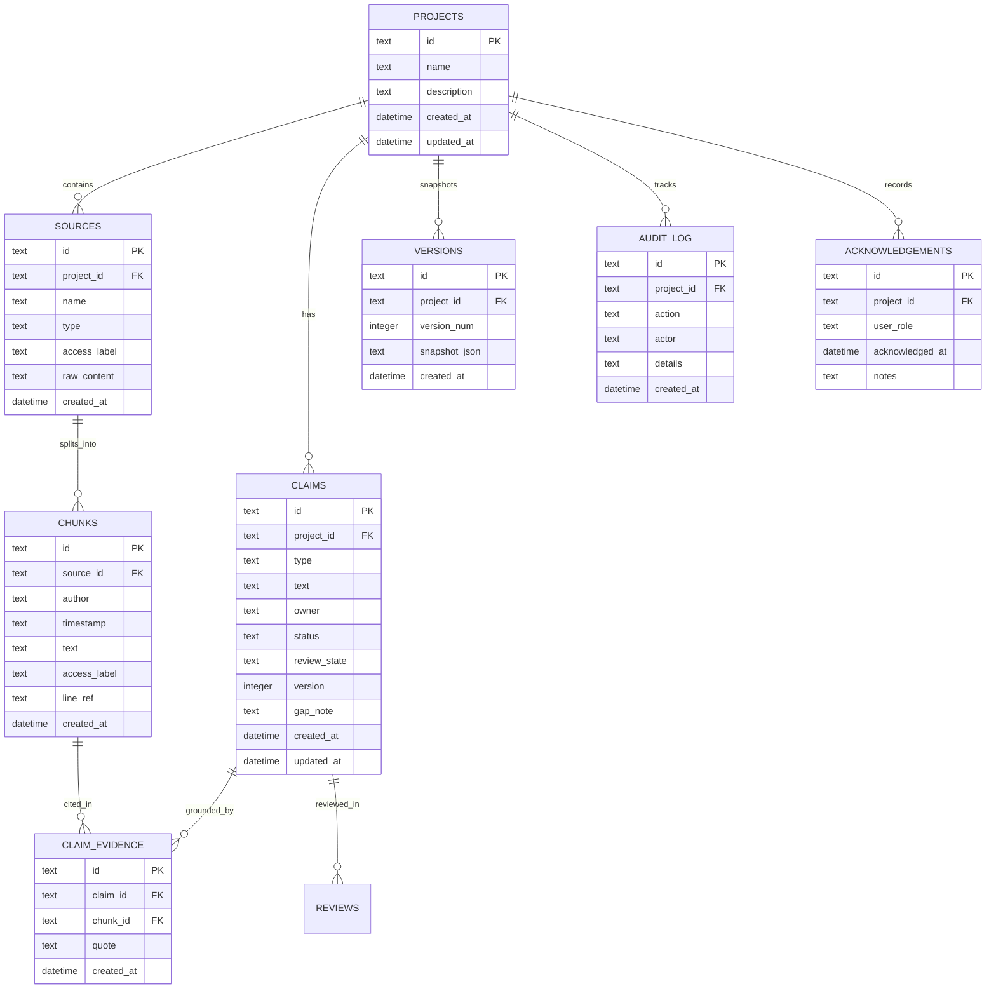

# Baton — System Architecture & Data Flow

This document details the internal technical architecture, data processing pipeline, and server-side security perimeter of **Baton**.

---

## 1. End-to-End Pipeline Diagram



---

## 2. Data Flow & Security Perimeter

### Phase 1: Ingestion & Chunker Isolation
1. **Sources Table:** Every file uploaded or loaded via demo receives a UUID, a file type (`notes`, `chat`, `tasks`), and an explicit access label (`team`, `leads-only`, `confidential`).
2. **Chunker Line Numbering:**
   - Markdown documents are split into logical paragraphs and bullet lists with exact start/end line coordinates (`L12-L15`).
   - Chat logs parse timestamps and authors, tracking individual chat message boundaries.
   - CSV task boards preserve task keys (`TASK-02`), categories, and assignees.
3. Every chunk inherits its parent source's `access_label`, ensuring immutable security tracking from day 0.

### Phase 2: Grounded Extraction Pipeline
- **Audit-Logged Scope:** Chunks are filtered by the reconstruct run's allowed access labels (`team`, `leads-only`, `confidential` for lead reconstruction). The exact set of labels utilized is permanently recorded in `audit_log`.
- **Extraction Schema Enforcement:** Gemini outputs structured JSON matching a strict schema:
  - `type`: `decision` | `owner` | `task` | `dependency` | `risk` | `recurring_problem`
  - `text`: Factual claim description.
  - `owner`: Responsible party or `null` if unassigned (the prompt explicitly forbids hallucinating assignees).
  - `chunk_ids`: UUIDs of the cited chunks.
  - `quote`: **Exact verbatim quote** copied word-for-word from the cited chunk.
- **Fail-Safe Cache:** If Google API quota limits occur (`429 Resource Exhausted`), the adapter fails fast and transparently falls back to `server/cache/demo-extraction.json`.

### Phase 3: Deterministic Verifier (Plain Code)
The verifier does **not** rely on LLM prompts; it is 100% plain deterministic code:
1. **Verbatim Check:** Whitespace and case-normalizes the cited quote and tests for substring containment in the referenced chunk text. Missing quotes are assigned `Unverified`.
2. **Source Counting:** Evaluates independent distinct `source_id` references across valid evidence:
   - $\ge 2$ independent sources $\rightarrow$ `Verified`
   - $1$ source $\rightarrow$ `Single-source`
3. **Contradiction Detection:** Evaluates claims of type `owner` or `dependency` addressing the same normalized subject. If distinct sources report different owners, status is marked `Conflicting` and both pieces of evidence are preserved for side-by-side comparison.
4. **Gap Identification:** Open tasks with no assignee or dependencies without a contact point are tagged `Missing` with explanatory audit notes.

### Phase 4: Server-Side Security Perimeter & Redaction
Access control is enforced **strictly on the server** in `server/src/access.js` and `server/src/routes.js`:

```
                       ROLE PRIVILEGES
          ┌─────────────┬────────────────────────────────────┐
          │ Role        │ Allowed Evidence Access Labels     │
          ├─────────────┼────────────────────────────────────┤
          │ lead        │ team, leads-only, confidential     │
          │ incoming    │ team, leads-only                   │
          │ restricted  │ team                               │
          └─────────────┴────────────────────────────────────┘
```

#### Where Access Checks Happen:
1. **`canSee(role, claim)` Function:**
   - Evaluates whether the requested role has permission to see **all** supporting evidence chunks.
   - If any single piece of evidence comes from an unauthorized chunk (e.g., `confidential`), the claim fails the access test.
2. **`filterOrRedactClaim(role, claim)` Function:**
   - If `canSee` fails, returns a redacted stub:  
     `{ id: claim.id, redacted: true, reason: "restricted" }`  
     **No text, no owner, and no evidence quotes** are included.
3. **Database-Level Timeline Query:**
   - In `GET /api/projects/:id/timeline`, chunks and sources are joined with:
     ```sql
     WHERE c.access_label IN (:allowedLabels) AND s.access_label IN (:allowedLabels)
     ```
   - This prevents confidential messages from ever being loaded into Node memory for restricted users.
4. **Code-Derived "Next Actions" Generation:**
   - Redacted claims are skipped during Next Actions generation to prevent accidental data leaks through task descriptions.

---

## 3. SQLite Database Schema (ER Diagram)


